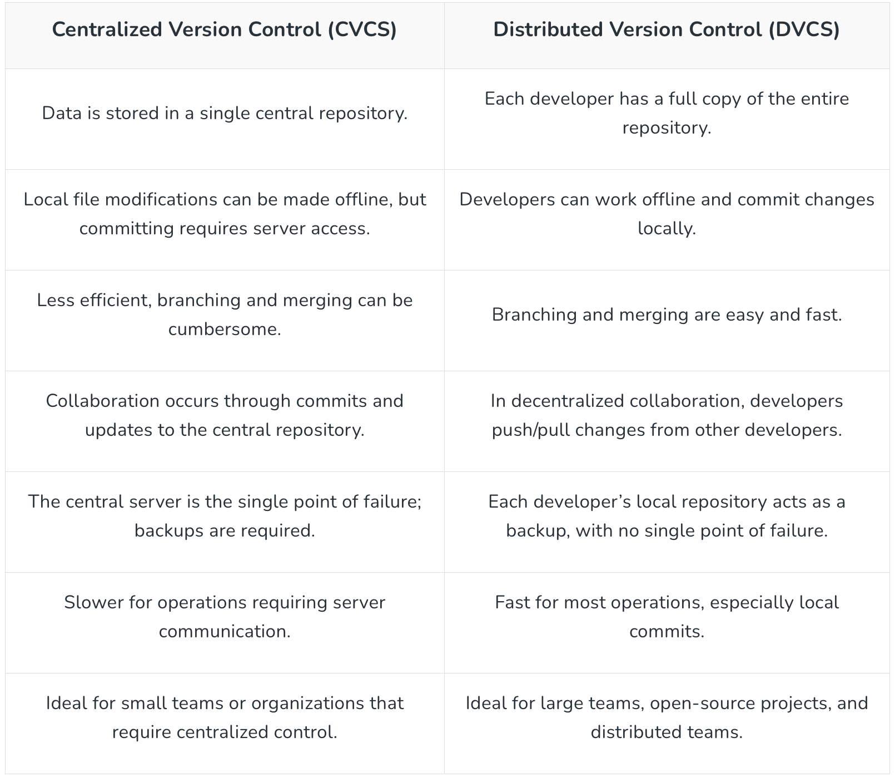
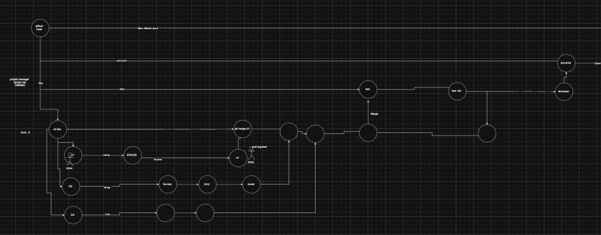
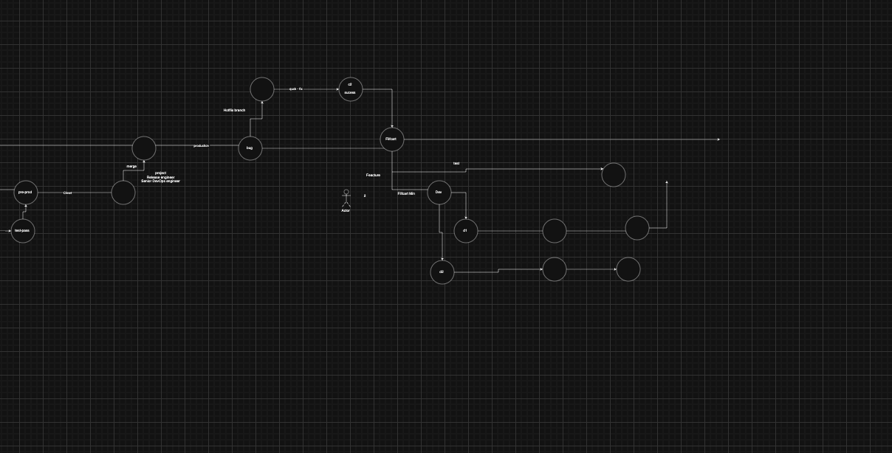

# SCM (Source Code Management) 

## What is SCM?
- SCM (Source Code Management) is the practice of tracking and managing changes to software code. 
- It helps developers collaborate, maintain code versions, and ensure consistency across a project.

## Difference Between Centralized VCS and Distributed VCS
- https://www.geeksforgeeks.org/git/centralized-vs-distributed-version-control-which-one-should-we-choose/

| Feature              | Centralized VCS (CVCS) | Distributed VCS (DVCS) |
|---------------------|---------------------|---------------------|
| Repository         | Single central repository | Multiple repositories (local + remote) |
| Example Tools     | SVN, Perforce        | Git, Mercurial      |
| Offline Work      | Not possible        | Possible (local commits) |
| Speed            | Slower (relies on central server) | Faster (local operations) |
| Collaboration     | Requires network access | Can work offline and push later |

## Git branches 
- https://www.atlassian.com/git/glossary#commands
## Git Branching

Branching in Git allows developers to work on different versions of a repository independently. Branches help manage features, fixes, and releases without affecting the main codebase.

### Common Types of Branches
1. **Main (Master) Branch** - The primary branch where production-ready code is maintained.
2. **Feature Branch** - Used to develop new features before merging into the main branch.
3. **Dev** - Used to store ongoing devlopment code
4. **Test** - Used to test the code in this branch 
5. **Release Branch** - Used for final testing before deploying a new version.
6. **Hotfix Branch** - Used to quickly patch critical issues in production.

### Git Branch Commands
- `git branch` → Lists all branches
- `git branch <branch_name>` → Creates a new branch
- `git checkout <branch_name>` → Switches to the specified branch
- `git switch <branch>` -> switch to specific branch  
- `git checkout -b <branch_name>` → Creates and switches to a new branch
- `git branch -d <branch_name>` → Deletes a local branch
- `git merge <branch_name>` → Merges specified branch into the current branch
- `git diff <branch1> <branch2>` → Shows differences between two branches
- `git push --set-upstream <origin> <branch name>` --> push branch on github (remote)
---

## Introduction to Remote Repositories (GitHub)
A remote repository is a version of your project stored on an online platform like GitHub, GitLab, or Bitbucket. It allows collaboration, backup, and deployment of your code.

### Essential Remote Repository Commands
- `git init` → Initializes a new Git repository in the current directory
- `git config --global user.name "Your Name"` → Sets your Git username
- `git config --global user.email "your.email@example.com"` → Sets your Git email
- `git remote add origin <repo_URL>` → Connects your local repository to a remote one
- `git clone <repo_URL>` → Clones a remote repository to your local machine
- `git pull origin <branch_name>` → Pulls the latest changes from the remote repository
- `git push origin <branch_name>` → Pushes local commits to the remote repository
---

